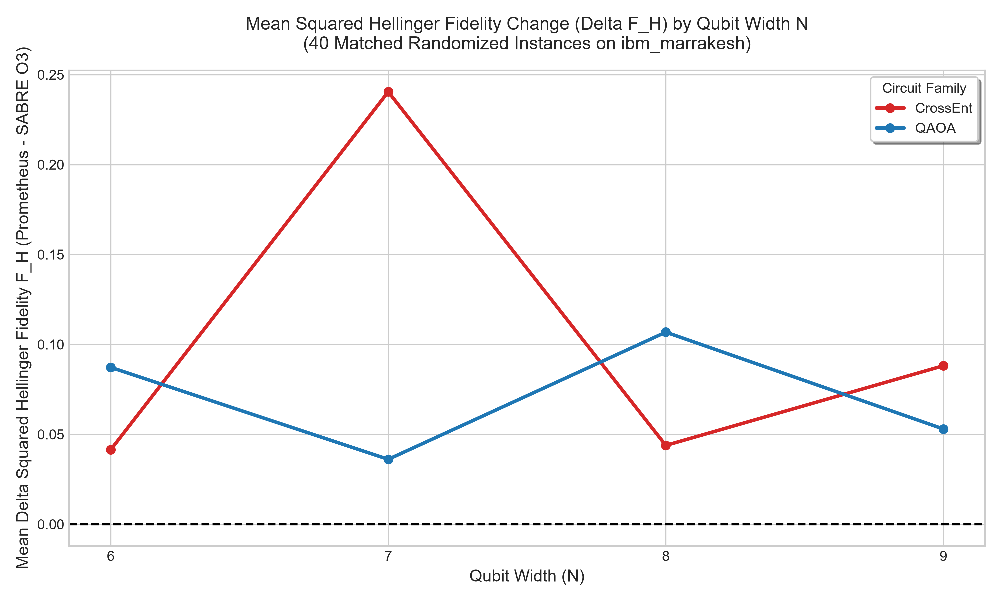

# Exploratory Studies of Physical Placement & Routing Trade-Offs

*Portfolio Hub: [Prometheus Quantum Overview](https://github.com/PrometheusDynamicsCanada/prometheus-quantum-overview) · [Master CSV](MASTER_RESULTS.csv) · [Reproduction Guide](REPRODUCE.md)*

**Routing around noisy couplers improved 75% (`30/40`) of randomized 6Q-to-9Q circuits on IBM Heron while losing 25% (`10/40`) where extra SWAP gates hurt more than noisy links.**

## At a Glance

- **Role in portfolio:** Exploratory mechanistic research (`5` studies, `14` IBM jobs, `774` PUBs, `4,125,440` shots) mapping where detour routing helps and where SWAP overhead dominates.
- **`6Q-9Q` randomized circuits (`Exp 02`):** Beat Qiskit SABRE O3 in **`30/40` (`75.0%`)** instances and lost in **`10/40` (`25.0%`)**.
- **Sector & width crossover (`Exp 03` & `05`):** Won `67%` of `6Q-7Q` QAOA runs on an uneven `ibm_marrakesh` sector, reversed to losses at `10Q` and on uniform sectors.
- **Concentration vs. accuracy (`Exp 01` & `04`):** Deeper paths shifted Shannon entropy independently of ideal-state accuracy and cut `13Q` all-zero (`0...0`) counts by **`-62.9%`** (`206` vs. `555` shots).

*Experiment 02 (`job-da1httsdedkc73er2k70` on `ibm_marrakesh`, `40` matched `6Q-9Q` pairs): `30/40` routing wins alongside the `10/40` SWAP-overhead boundary.*

---

## Summary of the Five Exploratory Studies (`14` IBM Heron Jobs, `774` PUBs, `4,125,440` Shots)

| Study | Processor(s) & Job ID(s) | Scope & Shots | Primary Metrics | Measured Finding |
| :--- | :--- | :--- | :--- | :--- |
| **[`01 - Concentration`](01-distributional-concentration/)** | `kingston`, `fez` (`8` jobs) | `5Q-8Q`, `100k` shots/circ | Entropy $H$, $D_{\text{KL}}$ `(↓)` | `7.0x` deeper `8Q` QFT lowered $H$ (**`6.60`** vs. `7.96` bits) while raising $D_{\text{KL}}$ (`1.64` vs. **`0.045`**) |
| **[`02 - Randomized 40`](02-randomized-instance-robustness/)** | `marrakesh` (`da1httsd..`) | `40` `6Q-9Q` pairs (`120` PUBs) | $F_H$ `(↑)`, `TVD` `(↓)` | **`30/40` (`75.0%`)** higher $F_H$ vs. SABRE; `10/40` SWAP-overhead losses |
| **[`03 - Width Crossover`](03-micro-gradient-scaling/)** | `marrakesh` (`da1do46g..`) | `3Q-10Q` (`96` PUBs, `960k` shots) | $F_H$ `(↑)`, `TVD` `(↓)` | Gains at `6Q-9Q` (`+0.12` to `+0.16` $F_H$) reversed at `10Q` (`-0.03` to `-0.06`) |
| **[`04 - 13Q All-Zero`](04-topological-mapping-ground-state-avoidance/)** | `kingston` (`d971l1gt..`) | `13Q` (`80k` shots/PUB) | `0...0` Count `(↓)`, $H$ | **`-62.9%`** fewer `0...0` shots (**`206`** vs. `555`) at `346` vs. `42` depth *(mechanism open)* |
| **[`05 - 3-QPU Sweep`](05-3qpu-mechanistic-sweep/)** | `fez`, `kingston`, `marrakesh` | `540` circs (`1,105,920` shots) | MaxCut $\langle C \rangle$, Top-1 | **`67%`** wins on uneven `marrakesh` `6Q-7Q`; trailed SABRE on uniform sectors & `8Q` |

*Metric Key:* `hellinger_fidelity` in [`MASTER_RESULTS.csv`](MASTER_RESULTS.csv) is $F_H = F_B^2$ `(↑)`.

- **Offline raw `BitArray` tensor verifiers:** `python verify_sha256_evidence.py` (plus per-study `verify_benchmark.py` scripts in [`REPRODUCE.md`](REPRODUCE.md))
- **Start a supported pilot:** [william@prometheusdynamics.ca](mailto:william@prometheusdynamics.ca) | [prometheusdynamics.ca](https://prometheusdynamics.ca)

---

## Supporting Depth-vs-Entropy Scatter Plot

<strong>Expand Physical Gate Depth vs. Measured Output Entropy Figure (Experiment 01) - Click to expand</strong>

*Physical depth vs. output Shannon entropy across `100` paired executions (`104.5` mean depth / `15.97` bits SABRE vs. `1,054.9` depth / `14.71` bits Prometheus).*

