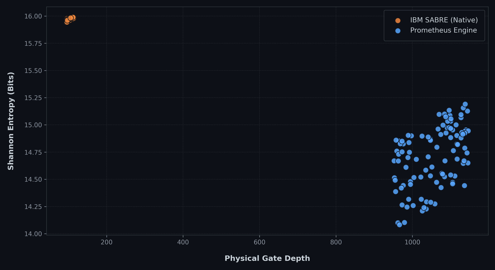

# Exploratory Studies of Coupler Avoidance vs. SWAP Overhead

*Portfolio Hub: [Prometheus Quantum Overview](https://github.com/PrometheusDynamicsCanada/prometheus-quantum-overview) · [Master CSV](MASTER_RESULTS.csv) · [Reproduction Guide](REPRODUCE.md)*

Routing a quantum circuit around a noisy hardware coupler avoids high two-qubit error rates but adds extra SWAP gates that introduce their own decoherence. Across five early exploratory studies on 156-qubit IBM Fez, Marrakesh, and Kingston, we measured when detour routing helps and when added gate depth hurts more than the bad links it avoids.

Across 40 matched 6-to-9-qubit randomized circuits on IBM Marrakesh, detour routing improved Squared Hellinger Fidelity over Qiskit SABRE O3 in 30 of 40 cases (75.0%) and lost in 10 of 40 cases (25.0%) where SWAP overhead dominated. Separate experiments documented how deeper paths alter output entropy and reduced all-zero bitstring counts on 13-qubit circuits by 62.9%.

Gains at 6 to 9 qubits reversed to losses at 10 qubits in uniform-sector tests, demonstrating why Prometheus's production compiler weighs coupler error against added gate count instead of routing around weak links unconditionally.

This repository contains the raw measurement archives and offline verification scripts from 14 exploratory IBM Quantum jobs (4.13 million measurement shots).

*Summary figure: Squared Hellinger Fidelity across 40 matched 6-to-9-qubit circuit pairs on IBM Marrakesh (30 detour wins alongside 10 SWAP-overhead losses).*

**[Read the detailed results](#detailed-results) · [Verify the data](#verify-the-data) · [Request an evaluation](https://prometheusdynamics.ca/connect/) · [Book a demonstration](mailto:william@prometheusdynamics.ca?subject=Prometheus%20Evaluation)**

---

## Summary of the Five Exploratory Studies (`14` IBM Heron Jobs, `774` PUBs, `4,125,440` Shots)

| Study | Processor(s) & Job ID(s) | Scope & Shots | Primary Metrics | Measured Finding |
| :--- | :--- | :--- | :--- | :--- |
| **[`01 - Concentration`](01-distributional-concentration/)** | `kingston`, `fez` (`8` jobs) | `5Q-8Q`, `100k` shots/circ | Entropy $H$, $D_{\text{KL}}$ `(↓)` | `7.0x` deeper `8Q` QFT lowered $H$ (**`6.60`** vs. `7.96` bits) while raising $D_{\text{KL}}$ (`1.64` vs. **`0.045`**) |
| **[`02 - Randomized 40`](02-randomized-instance-robustness/)** | `marrakesh` (`da1httsd..`) | `40` `6Q-9Q` pairs (`120` PUBs) | $F_H$ `(↑)`, `TVD` `(↓)` | **`30/40` (`75.0%`)** higher $F_H$ vs. SABRE; `10/40` SWAP-overhead losses |
| **[`03 - Width Crossover`](03-micro-gradient-scaling/)** | `marrakesh` (`da1do46g..`) | `3Q-10Q` (`96` PUBs, `960k` shots) | $F_H$ `(↑)`, `TVD` `(↓)` | Gains at `6Q-9Q` (`+0.12` to `+0.16` $F_H$) reversed at `10Q` (`-0.03` to `-0.06`) |
| **[`04 - 13Q All-Zero`](04-topological-mapping-ground-state-avoidance/)** | `kingston` (`d971l1gt..`) | `13Q` (`80k` shots/PUB) | `0...0` Count `(↓)`, $H$ | **`-62.9%`** fewer `0...0` shots (**`206`** vs. `555`) at `346` vs. `42` depth *(mechanism open)* |
| **[`05 - 3-QPU Sweep`](05-3qpu-mechanistic-sweep/)** | `fez`, `kingston`, `marrakesh` | `540` circs (`1,105,920` shots) | MaxCut $\langle C \rangle$, Top-1 | **`67%`** wins on uneven `marrakesh` `6Q-7Q`; trailed SABRE on uniform sectors & `8Q` |

*Metric Key:* `hellinger_fidelity` in [`MASTER_RESULTS.csv`](MASTER_RESULTS.csv) is Squared Hellinger Fidelity $F_H = F_B^2$ `(↑)`.

---

## Inspect the Evidence & Reproduce Supported Checks Offline

- **Command:** `python verify_sha256_evidence.py` (plus per-study `verify_benchmark.py` scripts in [`REPRODUCE.md`](REPRODUCE.md))
- **Dependencies & measured runtime:** Python 3 standard library (`0` cloud credentials, **`~0.04 s`** for `verify_sha256_evidence.py`; `numpy` for per-study tensor scripts).
- **Request an evaluation or book a demonstration:** [prometheusdynamics.ca/connect](https://prometheusdynamics.ca/connect/) | [william@prometheusdynamics.ca](mailto:william@prometheusdynamics.ca?subject=Prometheus%20Evaluation)

---

## Supporting Depth-vs-Entropy Scatter Plot

<strong>Expand Physical Gate Depth vs. Measured Output Entropy Figure (Experiment 01) - Click to expand</strong>

